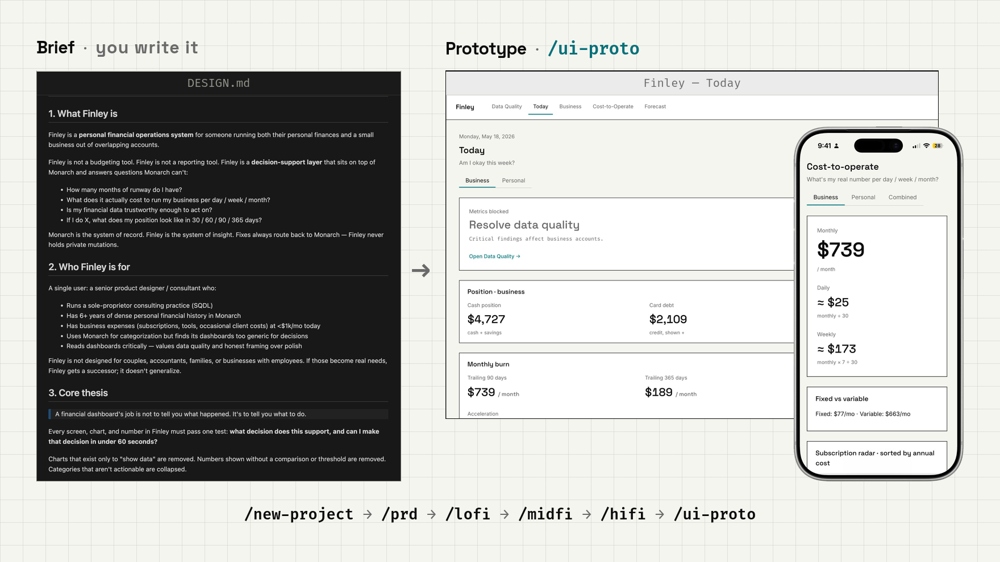
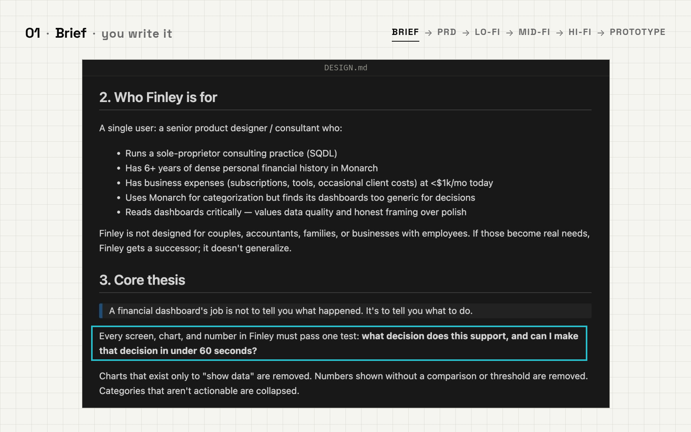
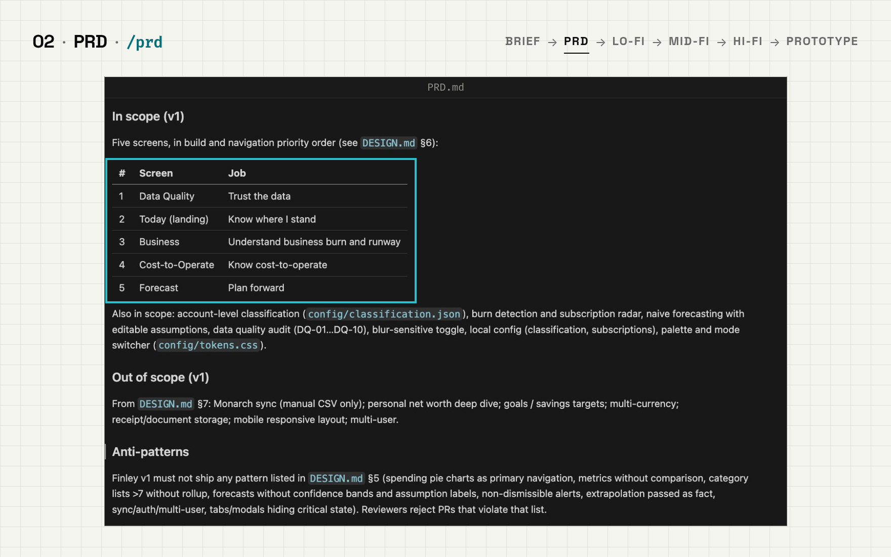
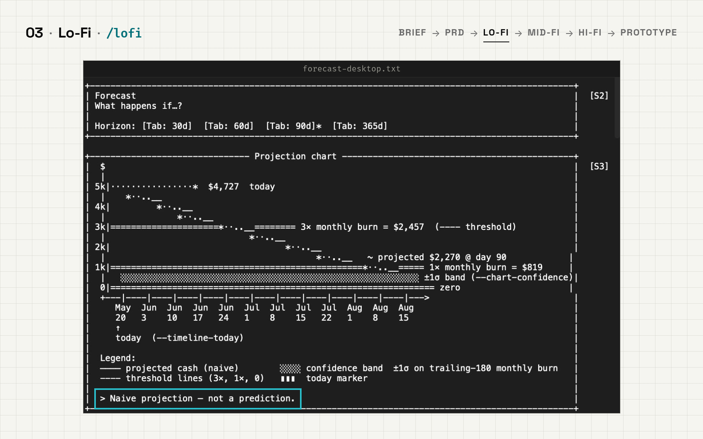
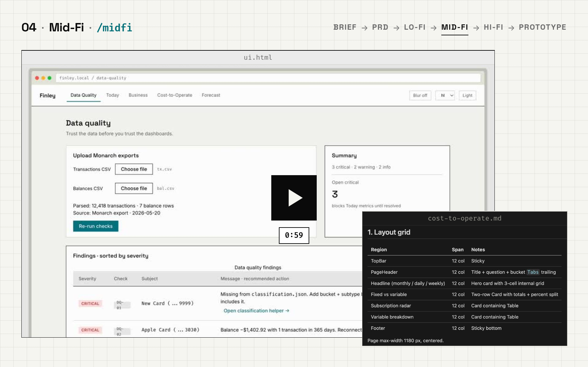
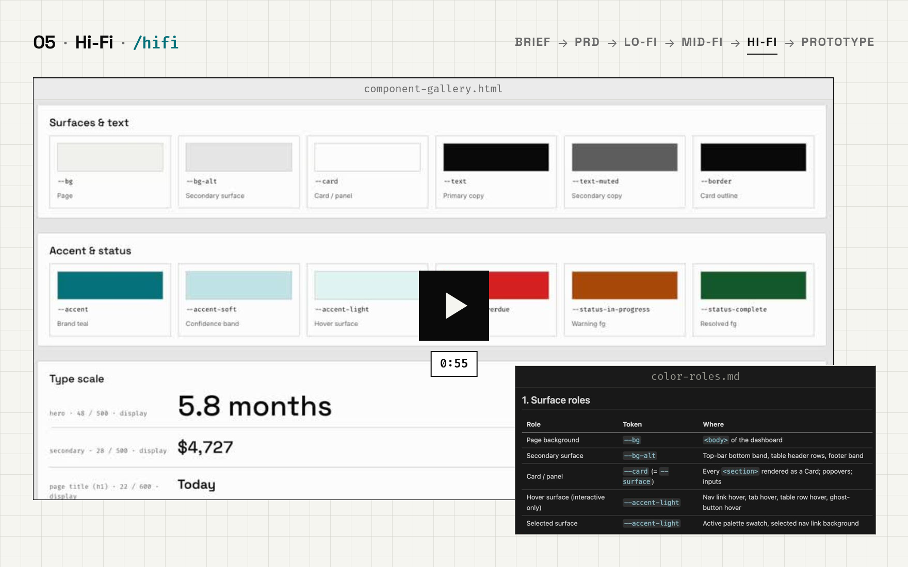
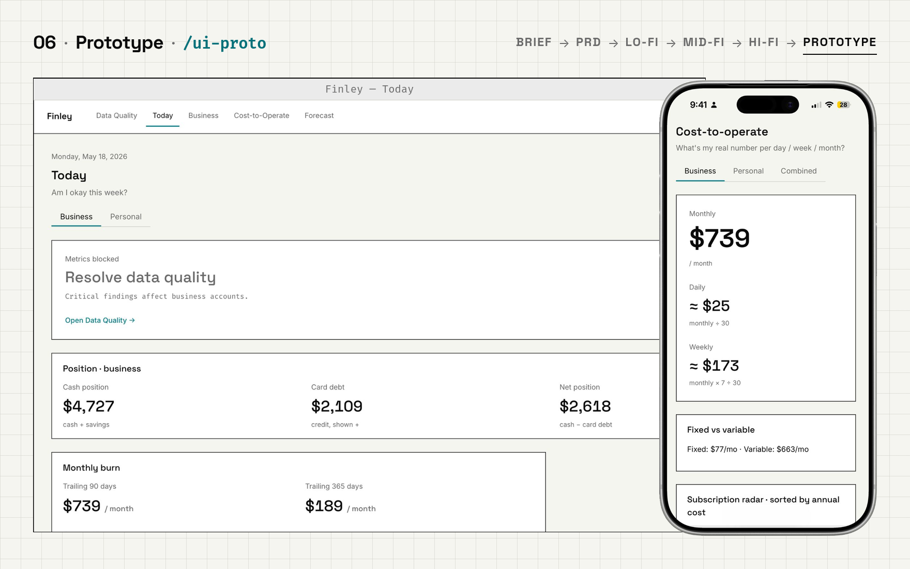
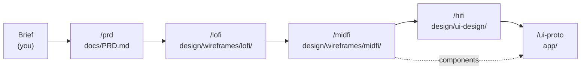

# AI Product Design Rules

**From a one-page brief to a clickable prototype in six commands. Cursor rules for designers who want the PRD, wireframes, UI kit, and prototype to come out organized and reviewable.**

<picture>
  <source media="(prefers-color-scheme: dark)" srcset="assets/editorial/hero-brief-to-prototype-dark.png">
  
</picture>

Each command plays a role on a small product team. Each one reads what the last one wrote, so the whole run leaves a paper trail you can review, edit, and rerun.

| Step | Command | Role | You get |
|---|---|---|---|
| 1 | `/new-project` | Project Manager | A project folder with `app/`, `docs/`, `design/` |
| 2 | `/prd` | Product Owner | `docs/PRD.md`, with requirements tied to metrics |
| 3 | `/lofi` | UX Designer | ASCII wireframes for mobile and desktop |
| 4 | `/midfi` | Product Designer | Tokens, components, states, and a `ui.html` overview |
| 5 | `/hifi` | UI Designer | Theme, color roles, and a component gallery |
| 6 | `/ui-proto` | UI Engineer | A clickable prototype (Next.js, Tailwind, shadcn/ui) |

Full inputs and outputs for every command are in [docs/commands.md](docs/commands.md).

## Install (about a minute)

From the root of your project, in a terminal:

```bash
mkdir -p .cursor/rules
base=https://raw.githubusercontent.com/luiscielak/ai-product-design-rules/main/.cursor/rules
for f in 00-workflow 01-new-project 02-prd 03-lofi 04-midfi 05-hifi 06-ui-proto; do
  curl -fsSL "$base/$f.mdc" -o ".cursor/rules/$f.mdc"
done
```

Then open the folder in Cursor and type `/new-project` in the Agent chat. That's it.

- `00-workflow.mdc` is always on. It knows the six commands and the folder layout.
- The six role rules load when you run their command, so they don't crowd every chat.
- Only want some stages? Drop the role files you don't need. Keep `00-workflow.mdc`.

Upgrading from the old `.cursorrules .yaml` file? Delete it and install the files above. Same rules, split into one file per role.

## Example: Finley, start to finish

Finley is a personal finance dashboard for a solo consultant whose personal and business money run through the same accounts. Here's the same product carried through every stage.

### The brief (you write this)

Finley is not a budgeting tool. It's a decision-support layer on top of Monarch: every screen, chart, and number has to answer "what decision does this support, and can I make it in under 60 seconds?"

<picture>
  <source media="(prefers-color-scheme: dark)" srcset="assets/editorial/finley-01-design-brief-dark.png">
  
</picture>

### 1. `/new-project`

Sets up `projects/finley/` with `app/`, `docs/`, and `design/` folders. Drop the brief in `docs/design-brief.md`.

### 2. `/prd`: scope it

The brief became five screens in priority order: Data Quality, Today, Business, Cost-to-Operate, Forecast. The PRD also lists the anti-patterns reviewers should reject, like metrics without a comparison.

<picture>
  <source media="(prefers-color-scheme: dark)" srcset="assets/editorial/finley-02-prd-dark.png">
  
</picture>

### 3. `/lofi`: one question per screen

Every screen answers one question. Cost-to-Operate asks "What's my real number per day / week / month?" Forecast has to say "Naive projection — not a prediction" right on the chart.

<picture>
  <source media="(prefers-color-scheme: dark)" srcset="assets/editorial/finley-03-lofi-dark.png">
  
</picture>

### 4. `/midfi`: structure and states

The ASCII frames turned into a 12-column grid, a spacing and type scale, and named components, previewed in a browser frame.

<!-- TODO(Luis): GitHub doesn't play <video src="https://raw.githubusercontent.com/..."> in READMEs.
     To get an inline player: edit README.md in the GitHub web editor, drag assets/finley-04-midfi-demo.mp4 into this spot,
     and GitHub uploads it and inserts a https://github.com/user-attachments/assets/... URL on its own line.
     Then delete the poster link below. Don't hand-write that URL. -->
<a href="assets/finley-04-midfi-demo.mp4">
  <picture>
    <source media="(prefers-color-scheme: dark)" srcset="assets/editorial/finley-04-midfi-poster-dark.png">
    
  </picture>
</a>

### 5. `/hifi`: give every token one job

Tokens became a theme where every color has exactly one role, documented next to a live component gallery.

<!-- TODO(Luis): same as above. Drag assets/finley-05-hifi-demo.mp4 in here with the GitHub web editor, then delete the poster link below. -->
<a href="assets/finley-05-hifi-demo.mp4">
  <picture>
    <source media="(prefers-color-scheme: dark)" srcset="assets/editorial/finley-05-hifi-poster-dark.png">
    
  </picture>
</a>

### 6. `/ui-proto`: click through it

All five screens, clickable on desktop and phone. Finley's brief asked for a single static HTML file with no build step, so the prototype followed the brief instead of the Next.js default. You can override `framework` the same way.

<picture>
  <source media="(prefers-color-scheme: dark)" srcset="assets/editorial/finley-06-prototype-dark.png">
  
</picture>

## Quick start: the Finley run

These are the commands for the run above. The inputs are example values written for this README, not a log of the original session. Swap in your own product.

```text
/new-project project_name:"finley" include_marketing:false

/prd using docs/design-brief.md

/lofi screens:[data-quality, today, business, cost-to-operate, forecast] primary_flows:[import-csv-and-fix-data, check-runway, plan-forward] breakpoints:[mobile, desktop]

/midfi screens:[data-quality, today, business, cost-to-operate, forecast] accessibility_targets:"WCAG AA"

/hifi theme:"both" brand_color:"#05717B"

/ui-proto framework:"single static HTML file" data:"mock" theming:"both"
```

You don't have to pass every input. If something critical is missing, the agent asks once, then goes ahead with sensible defaults and writes down its assumptions.

## What you end up with

```
projects/{project_name}/
├── app/                      # The prototype (Next.js by default)
│   ├── src/app/              # App Router pages
│   └── src/components/ui/    # shadcn/ui components
├── docs/
│   ├── design-brief.md       # Your brief (optional)
│   ├── PRD.md
│   └── presentations/
├── design/
│   ├── wireframes/
│   │   ├── lofi/             # ASCII frames + legend.md
│   │   └── midfi/            # tokens.md, components.md, screens/, ui.html
│   └── ui-design/            # theme, color roles, component gallery
└── marketing/                # Optional
```

## Why this order

`/hifi` runs before `/ui-proto` because the prototype applies the hi-fi theme. Every stage checks that the previous output exists, and offers to create it if it's missing.



## Limitations

- **Output varies.** Different models, and different runs of the same model, produce different artifacts. Review each stage before moving on.
- **ASCII lo-fi gets slow on dense screens.** Tables and charts take a while and get hard to read. Keep lo-fi to structure.
- **Rules are instructions, not code.** The agent can skip a step or an acceptance check. The checklists in [docs/commands.md](docs/commands.md) make reviews faster.
- **The commands are typed text, not menu items.** `/prd` and the rest won't show up in Cursor's `/` menu. The always-on workflow rule tells the agent what they mean.
- **The default stack is Next.js, Tailwind CSS v4, and shadcn/ui.** Other stacks work through the `framework` input but get less testing.

**Tested with:** Cursor 3.24.12 (October 2026)

## Contributing

Ideas and fixes are welcome. Open a PR with the reason for the change and how you'd check it worked.

- Change the rule in `.cursor/rules/` and the matching section of `docs/commands.md` in the same PR.
- Keep command names, stage order, and folder paths the same across rules, docs, and this README.
- If you change a stage's output, run the next stage once to make sure it still finds what it needs.

## License

MIT. See [LICENSE](LICENSE).
