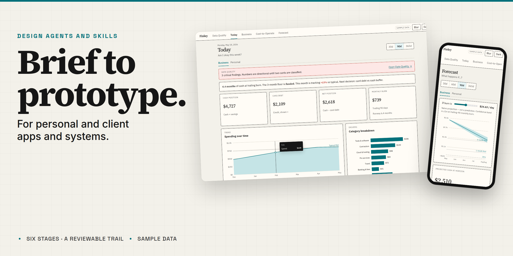
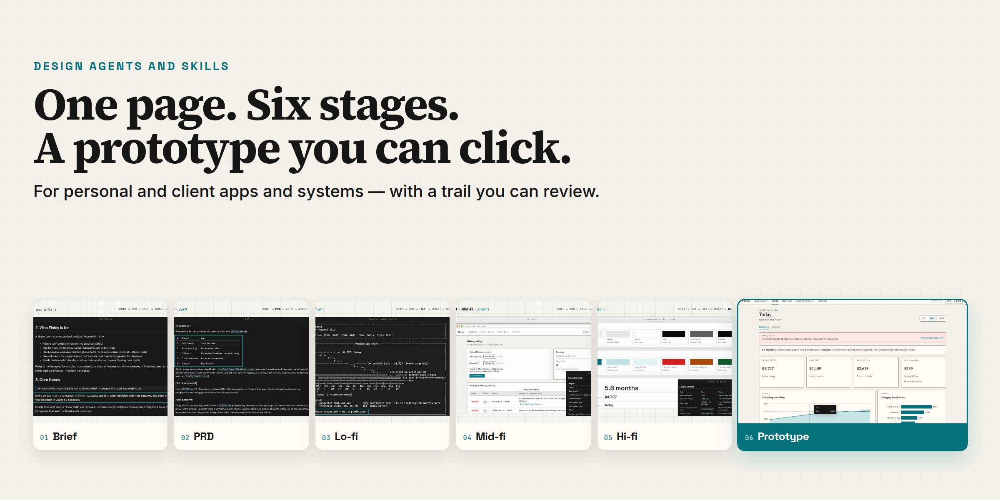
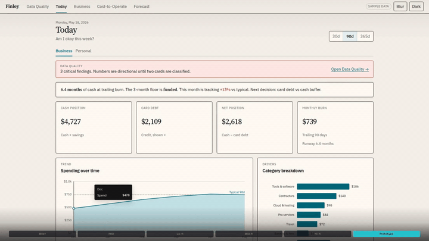
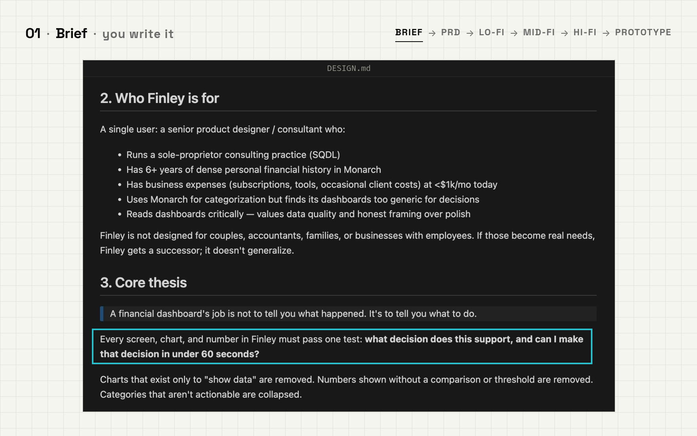
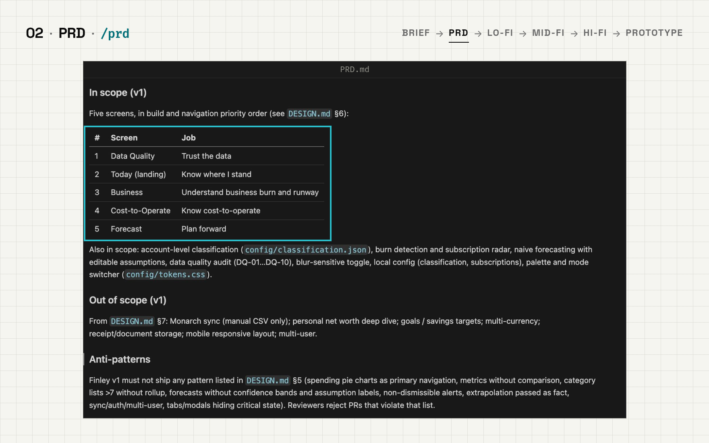
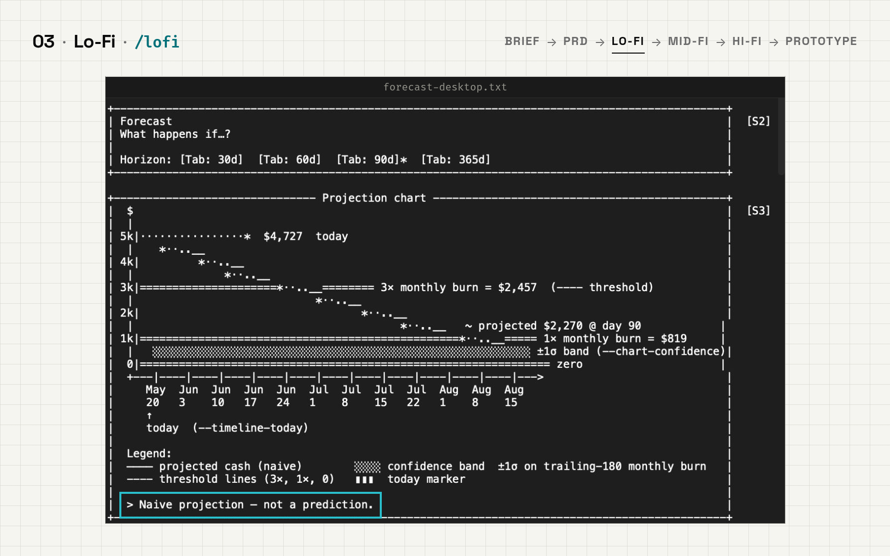
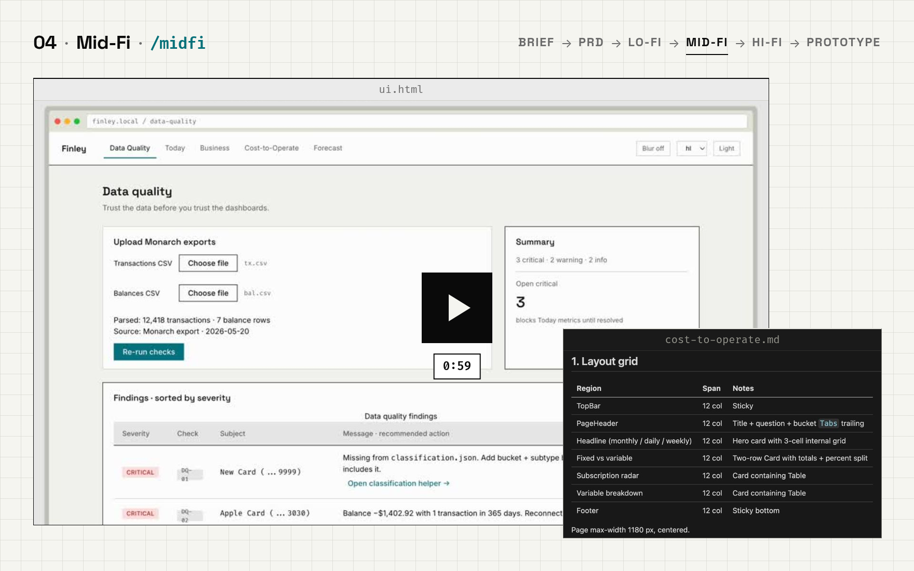
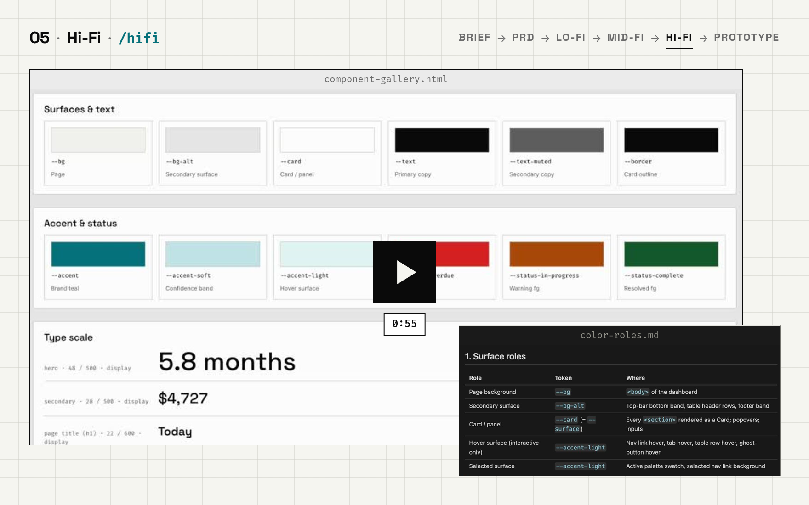
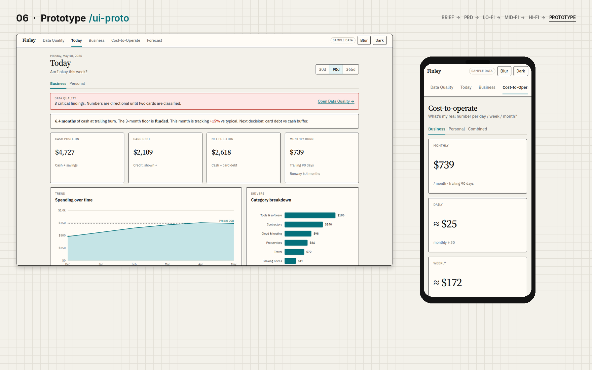
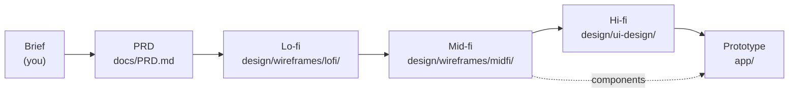

<a href="demo/showreel/out/finley-showreel-16x9.mp4">
  <picture>
    <source media="(prefers-color-scheme: dark)" srcset="demo/cover/out/a-editorial-dark.png">
    
  </picture>
</a>

# AI Product Design

**Design agents that take a one-page brief to a prototype you can click — without skipping the product thinking.**

Six staged skills, six roles on a small product team. Each stage reads what the last one wrote, so the PRD, wireframes, UI kit, and coded prototype stay in one reviewable trail. Built for any AI coding or agent environment that can follow structured skills.

Silent 42s teaser · [16:9](demo/showreel/out/finley-showreel-16x9.mp4) · [9:16](demo/showreel/out/finley-showreel-9x16.mp4) · sample data

The walkthrough below is **Finley**, a personal finance dashboard for a solo consultant. Same product at every stage. All figures in the prototype are sample data.

## The path

<picture>
  <source media="(prefers-color-scheme: dark)" srcset="demo/cover/out/b-pipeline-dark.png">
  
</picture>

| Stage | Role | You get |
|---|---|---|
| 1. Project setup | Project Manager | A project folder with `app/`, `docs/`, `design/` |
| 2. PRD | Product Owner | `docs/PRD.md`, with requirements tied to metrics |
| 3. Lo-fi | UX Designer | ASCII wireframes for mobile and desktop |
| 4. Mid-fi | Product Designer | Tokens, components, states, and a `ui.html` overview |
| 5. Hi-fi | UI Designer | Theme, color roles, and a component gallery |
| 6. Prototype | UI Engineer | A clickable prototype (Next.js by default; Finley uses static HTML) |

In Cursor these stages are slash commands (`/new-project`, `/prd`, `/lofi`, `/midfi`, `/hifi`, `/ui-proto`). The same skills live in [`.cursor/skills/`](.cursor/skills/) and [`.cursor/rules/`](.cursor/rules/). Full inputs and outputs: [docs/commands.md](docs/commands.md).

## Install (about a minute)

From the root of your project:

```bash
mkdir -p .cursor/rules
base=https://raw.githubusercontent.com/luiscielak/ai-product-design-rules/main/.cursor/rules
for f in 00-workflow 01-new-project 02-prd 03-lofi 04-midfi 05-hifi 06-ui-proto; do
  curl -fsSL "$base/$f.mdc" -o ".cursor/rules/$f.mdc"
done
```

Then open the folder in an agent chat and start with project setup. That's it.

- `00-workflow.mdc` is always on. It knows the six stages and the folder layout.
- The six role rules load when you run their stage, so they don't crowd every chat.
- Only want some stages? Drop the role files you don't need. Keep `00-workflow.mdc`.

Upgrading from the old `.cursorrules.yaml` file? Delete it and install the files above. Same rules, split into one file per role.

## Example: Finley, start to finish

Finley is a personal finance dashboard for a solo consultant whose personal and business money run through the same accounts. It is not a generic budgeting app. Every screen has to answer a decision in under a minute.

[](demo/showreel/out/finley-showreel-16x9.mp4)

### The brief (you write this)

Every screen, chart, and number has to pass: *what decision does this support, and can I make it in under 60 seconds?*

<picture>
  <source media="(prefers-color-scheme: dark)" srcset="assets/editorial/finley-01-design-brief-dark.png">
  
</picture>

### 1. Project setup

Sets up `projects/finley/` with `app/`, `docs/`, and `design/` folders. Drop the brief in `docs/design-brief.md`.

### 2. PRD: scope it

The brief became five screens in priority order: Data Quality, Today, Business, Cost-to-Operate, Forecast. The PRD also lists the anti-patterns reviewers should reject, like metrics without a comparison.

<picture>
  <source media="(prefers-color-scheme: dark)" srcset="assets/editorial/finley-02-prd-dark.png">
  
</picture>

### 3. Lo-fi: one question per screen

Every screen answers one question. Cost-to-Operate asks "What's my real number per day / week / month?" Forecast has to say "Naive projection — not a prediction" right on the chart.

<picture>
  <source media="(prefers-color-scheme: dark)" srcset="assets/editorial/finley-03-lofi-dark.png">
  
</picture>

### 4. Mid-fi: structure and states

The ASCII frames turned into a 12-column grid, a spacing and type scale, and named components, previewed in a browser frame.

<!-- TODO(Luis): GitHub doesn't play <video src="https://raw.githubusercontent.com/..."> in READMEs.
     To get an inline player: edit README.md in the GitHub web editor, drag assets/finley-04-midfi-demo.mp4 into this spot,
     and GitHub uploads it and inserts a https://github.com/user-attachments/assets/... URL on its own line.
     Then delete the poster link below. Don't hand-write that URL. -->
<a href="assets/finley-04-midfi-demo.mp4">
  <picture>
    <source media="(prefers-color-scheme: dark)" srcset="assets/editorial/finley-04-midfi-poster-dark.png">
    
  </picture>
</a>

### 5. Hi-fi: give every token one job

Tokens became a theme where every color has exactly one role, documented next to a live component gallery.

<!-- TODO(Luis): same as above. Drag assets/finley-05-hifi-demo.mp4 in here with the GitHub web editor, then delete the poster link below. -->
<a href="assets/finley-05-hifi-demo.mp4">
  <picture>
    <source media="(prefers-color-scheme: dark)" srcset="assets/editorial/finley-05-hifi-poster-dark.png">
    
  </picture>
</a>

### 6. Prototype: click through it

All five screens, with charts you can hover and filter. Finley's brief asked for a single static HTML file with no build step, so the prototype followed the brief instead of the Next.js default.

<picture>
  <source media="(prefers-color-scheme: dark)" srcset="assets/editorial/finley-06-prototype-dark.png">
  
</picture>

**Run it locally** (sample data only):

```bash
cd projects/finley/app
python3 -m http.server 4173
```

Open [http://localhost:4173](http://localhost:4173). Try the 30 / 90 / 365-day range on Today, the burn slider on Forecast, and light / dark. Setup notes: [projects/finley/app/README-proto.md](projects/finley/app/README-proto.md).

## Quick start: the Finley run

These are the stage prompts for the run above. The inputs are example values written for this README, not a log of the original session. Swap in your own product.

```text
/new-project project_name:"finley" include_marketing:false

/prd using docs/design-brief.md

/lofi screens:[data-quality, today, business, cost-to-operate, forecast] primary_flows:[import-csv-and-fix-data, check-runway, plan-forward] breakpoints:[mobile, desktop]

/midfi screens:[data-quality, today, business, cost-to-operate, forecast] accessibility_targets:"WCAG AA"

/hifi theme:"both" brand_color:"#05717B"

/ui-proto framework:"single static HTML file" data:"mock" theming:"both"
```

You don't have to pass every input. If something critical is missing, the agent asks once, then goes ahead with sensible defaults and writes down its assumptions.

## What you end up with

```
projects/{project_name}/
├── app/                      # The prototype (Next.js by default)
│   ├── src/app/              # App Router pages
│   └── src/components/ui/    # shadcn/ui components
├── docs/
│   ├── design-brief.md       # Your brief (optional)
│   ├── PRD.md
│   └── presentations/
├── design/
│   ├── wireframes/
│   │   ├── lofi/             # ASCII frames + legend.md
│   │   └── midfi/            # tokens.md, components.md, screens/, ui.html
│   └── ui-design/            # theme, color roles, component gallery
└── marketing/                # Optional
```

Finley's prototype is the static exception: `projects/finley/app/index.html`.

## Why this order

Hi-fi runs before the prototype because the prototype applies the hi-fi theme. Every stage checks that the previous output exists, and offers to create it if it's missing.



## Limitations

- **Output varies.** Different models, and different runs of the same model, produce different artifacts. Review each stage before moving on.
- **ASCII lo-fi gets slow on dense screens.** Tables and charts take a while and get hard to read. Keep lo-fi to structure.
- **Skills are instructions, not code.** The agent can skip a step or an acceptance check. The checklists in [docs/commands.md](docs/commands.md) make reviews faster.
- **In Cursor, the stage names are typed text, not menu items.** `/prd` and the rest won't show up in the `/` menu. The always-on workflow rule tells the agent what they mean.
- **The default stack is Next.js, Tailwind CSS v4, and shadcn/ui.** Other stacks work through the `framework` input but get less testing.

**Tested with:** Cursor 3.24.12 (October 2026)

## Contributing

Ideas and fixes are welcome. Open a PR with the reason for the change and how you'd check it worked.

- Change the rule in `.cursor/rules/` and the matching section of `docs/commands.md` in the same PR.
- Keep stage names, stage order, and folder paths the same across rules, docs, and this README.
- If you change a stage's output, run the next stage once to make sure it still finds what it needs.

## License

MIT. See [LICENSE](LICENSE).
