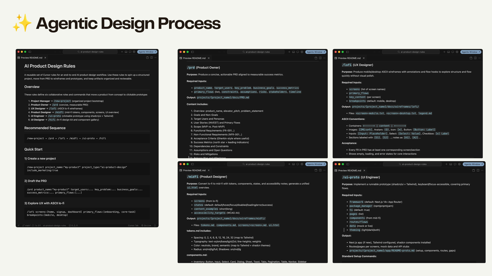
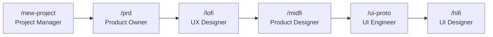
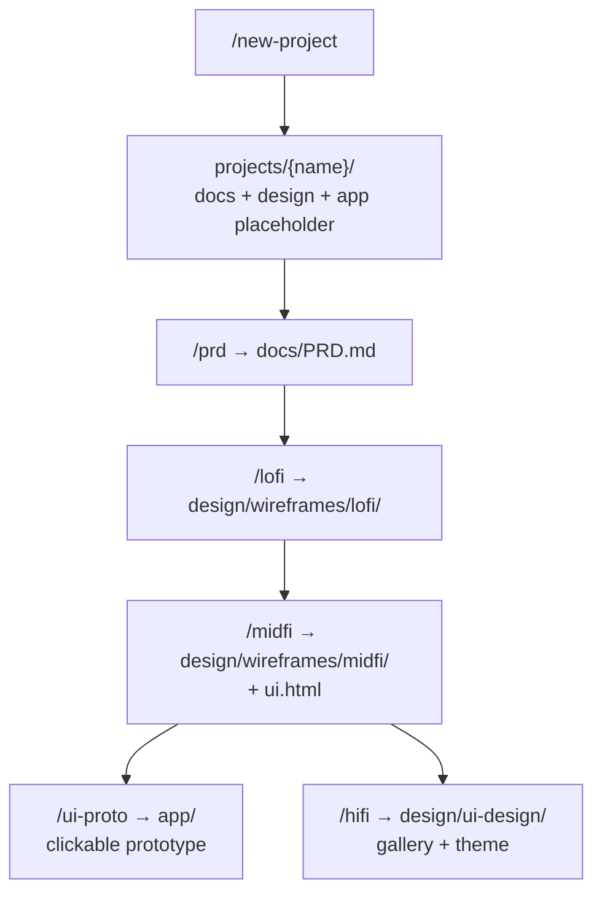
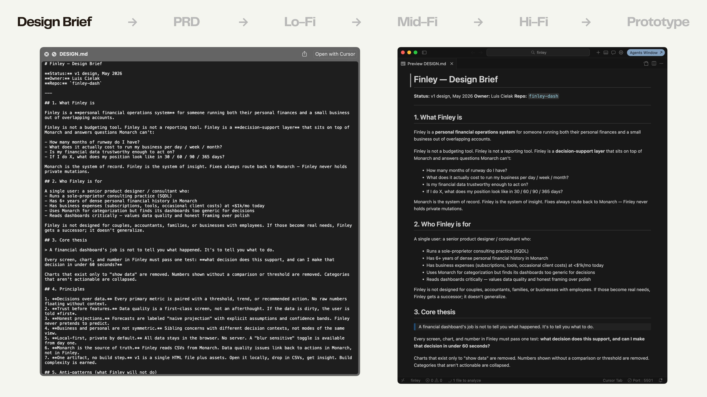
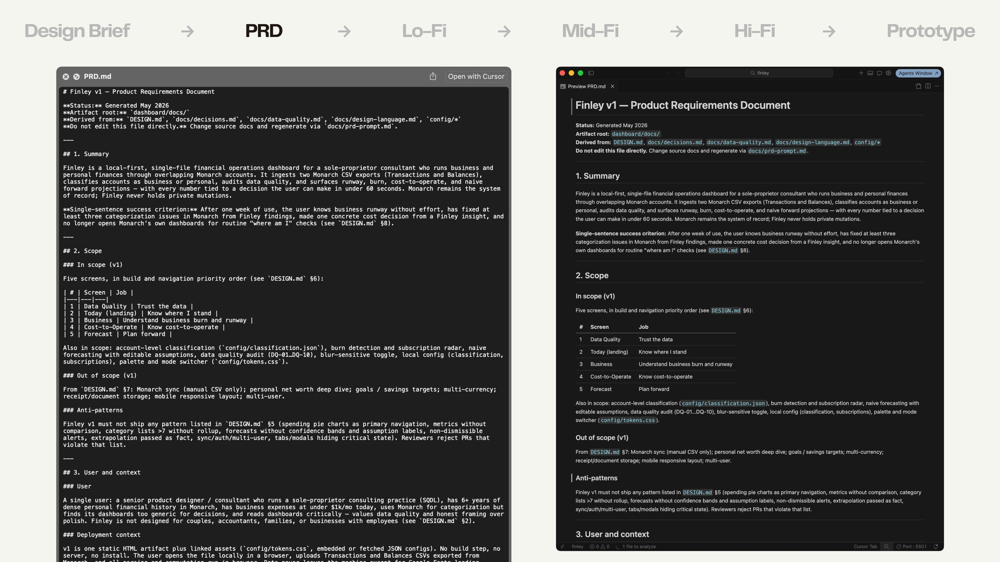
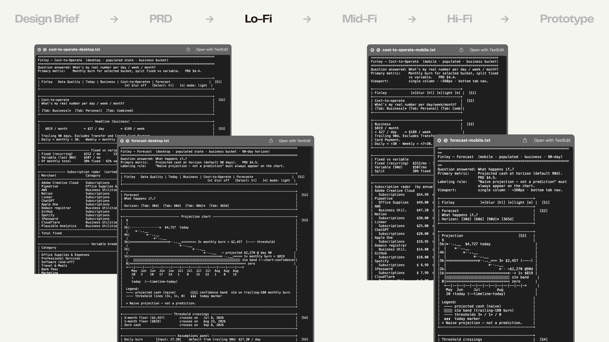
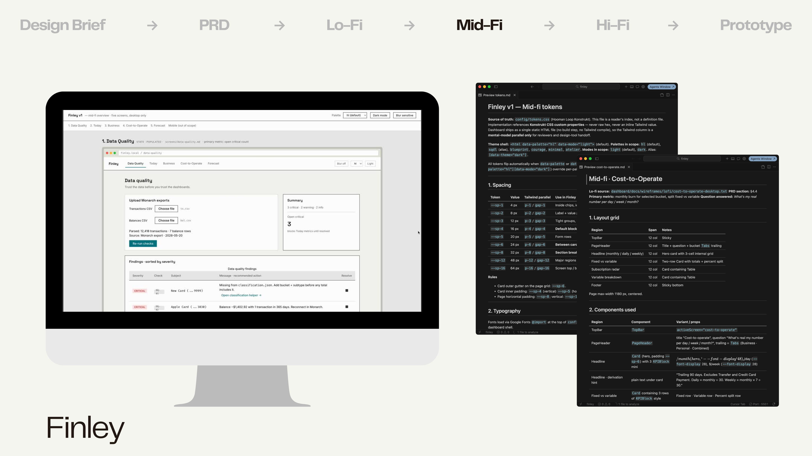
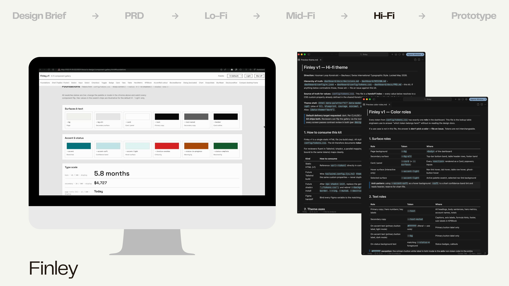
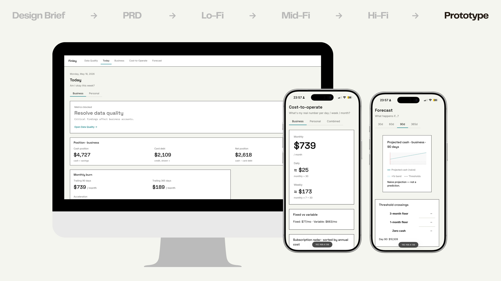
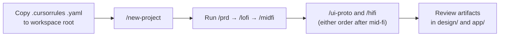

# AI Product Design Rules

A reusable set of Cursor rules for an end‑to‑end AI product design workflow. Use these rules to spin up a structured project, move from PRD to wireframes and prototypes, and keep artifacts organized and reviewable.



## Overview

These rules define six collaborative roles and commands that move a product from concept to clickable prototype:

1. **Project Manager** → `/new-project` (organized project bootstrap)
2. **Product Owner** → `/prd` (concise, measurable PRD)
3. **UX Designer** → `/lofi` (ASCII lo‑fi wireframes)
4. **Product Designer** → `/midfi` (mid‑fi tokens, components, screens, UI overview)
5. **UI Engineer** → `/ui-proto` (clickable prototype; shadcn/ui + Tailwind by default, or Konstrukt when `design_system:"konstrukt"`)
6. **UI Designer** → `/hifi` (hi‑fi design kit and component gallery)



Each step consumes the artifact produced by the previous step and writes its own output into `projects/{project_name}/`.

## Recommended Sequence

The commands are designed to run in order. Each stage produces an artifact that the next stage builds on—so the pipeline doubles as an artifact handoff.



Both `/ui-proto` and `/hifi` build on mid‑fi only. Hi‑fi is **optional** before `/ui-proto`. Either order after `/midfi` is valid. Default:

```
/new-project → /prd → /lofi → /midfi → /ui-proto → /hifi
```

## Example: Finley walkthrough

The same product ("Finley") carried through every stage of the pipeline.

### 1. Design Brief


### 2. PRD (`/prd`)


### 3. Lo‑Fi (`/lofi`)


### 4. Mid‑Fi (`/midfi`)


<video src="https://raw.githubusercontent.com/luiscielak/ai-product-design-rules/main/assets/finley-04-midfi-demo.mp4" controls muted loop poster="assets/finley-04-midfi.jpg" width="100%"></video>

### 5. Hi‑Fi (`/hifi`)


<video src="https://raw.githubusercontent.com/luiscielak/ai-product-design-rules/main/assets/finley-05-hifi-demo.mp4" controls muted loop poster="assets/finley-05-hifi.jpg" width="100%"></video>

### 6. Prototype (`/ui-proto`)


## Quick Start

### 1) Create a new project
```
/new-project project_name:"my-product" project_type:"ai-product-design" include_marketing:true design_system:"shadcn"
```

### 2) Draft the PRD
```
/prd product_name:"my-product" target_users:... key_problem:... business_goals:... success_metrics:... primary_flows:[...]
```

### 3) Explore UX with ASCII lo‑fi
```
/lofi screens:[home, signup, dashboard] primary_flows:[onboarding, core-task] breakpoints:[mobile, desktop]
```

### 4) Define mid‑fi wireframes
```
/midfi screens:[...] states:[default, hover, focus, disabled, loading, error, success] design_system:"shadcn"
```

### 5) Build a clickable prototype
```
/ui-proto framework:"Next.js App Router" package_manager:"npm" ts:true pages:[...] components:[...] theming:"both" design_system:"shadcn"
```

### 6) Deliver the hi‑fi UI kit
```
/hifi theme:"dark" brand_color:"#5B8DEF" components:[...] design_system:"shadcn"
```

## Folder Structure (generated)

```
projects/{project_name}/
├── app/                         # Next.js prototype (/ui-proto)
│   ├── src/app/
│   └── components/ui/           # shadcn only
├── docs/
│   ├── PRD.md
│   └── presentations/
├── design/
│   ├── wireframes/lofi/         # /lofi
│   ├── wireframes/midfi/        # /midfi
│   └── ui-design/               # /hifi
├── vendor/konstrukt-2.0.0/      # when design_system is konstrukt
└── marketing/                   # (optional)
```

## Command Reference

### Design system

`design_system` is `shadcn` | `konstrukt` and **defaults to `shadcn`**. The stacks are exclusive: do not install shadcn in a Konstrukt project or vendor Konstrukt into a shadcn project.

When `konstrukt` is set, `/midfi`, `/hifi`, and `/ui-proto` consume [Konstrukt v2.0.0](https://github.com/the-hooman-loop/konstrukt) generated `dist/` files. The npm package is private — copy `konstrukt.css`, `base.css`, `theme.js`, and `tokens.json` from git tag `v2.0.0` into `vendor/konstrukt-2.0.0/`. Never hand-type hex. Ban radius, shadow, and gradient. Light/dark is `data-mode` on `<html>`. Persist the choice in the project README.

### `/new-project` (Project Manager)
**Purpose:** Create an organized project structure for AI product design workflows.

**Inputs:**
- `project_name` (kebab‑case, e.g., "foto-sage", "chat-assistant")
- `project_type` (default: "ai-product-design")
- `include_marketing` (default: true)
- `design_system` (`shadcn` | `konstrukt`, default: `shadcn`)

**Output:**
- `projects/{project_name}/` with:
  - `docs/` (PRD + presentations)
  - `design/wireframes/{lofi,midfi}/` and `design/ui-design/`
  - `app/` placeholder (`/ui-proto` scaffolds the runnable app)
  - `vendor/konstrukt-2.0.0/` when `design_system` is `konstrukt`
  - `marketing/` (if requested)
- README templates and basic setup files

**Acceptance:**
- Structure follows the established pattern
- Generated app runs with `npm install && npm run dev`
- README includes setup and usage instructions

---

### `/prd` (Product Owner)
**Purpose:** Produce a concise, actionable PRD aligned to measurable success metrics.

**Required Inputs:**
- `product_name`, `target_users`, `key_problem`, `business_goals`, `success_metrics`
- `primary_flows` (list), `constraints`, `assumptions`, `risks`, `stakeholders`, `timeline`

**Output:** `projects/{project_name}/docs/PRD.md`

**Content includes:**
1. Overview: product_name, elevator_pitch, problem_statement
2. Goals and Non‑Goals
3. Target Users and Personas
4. User Stories (INVEST) and Primary Flows
5. Scope (MVP vs. Post‑MVP)
6. Functional Requirements (FR‑001…)
7. Non‑Functional Requirements (NFR‑001…)
8. Acceptance Criteria (Gherkin‑style where useful)
9. Success Metrics (north star + leading indicators)
10. Dependencies and Constraints
11. Assumptions and Open Questions
12. Risks and Mitigations
13. Release Plan and Milestones

**Acceptance:**
- All FRs map to at least one user story and metric
- Each metric has a target, timeframe, and measurement method

---

### `/lofi` (UX Designer)
**Purpose:** Produce mobile/desktop ASCII wireframes with annotations and flow hooks to explore structure and flow quickly without visual polish.

**Required Inputs:**
- `screens` (list of screen names)
- `primary_flows`
- `key_content` (per screen)
- `breakpoints` (default: mobile, desktop)

**Output:** `projects/{project_name}/design/wireframes/lofi/`
- Files: `<screen>-mobile.txt`, `<screen>-desktop.txt`, `legend.md`

**ASCII Conventions:**
- Containers: `+------+ | content | +------+`
- Images: `[IMG:w×h]`, Avatars: `(O)`, Icon: `[*]`, Button: `[Button: Label]`
- Inputs: `[Input: Placeholder]`, Select: `[Select: Value]`, Checkbox: `[x] Label`
- Sections labeled with `[S1]`, `[S2]` ...; notes as `[A1]`, `[A2]`...

**Acceptance:**
- Every FR in PRD has at least one corresponding screen/section
- Shows empty, loading, and error states for core interactions

---

### `/midfi` (Product Designer)
**Purpose:** Convert lo‑fi to mid‑fi with tokens, components, states, and accessibility notes; generate a unified `ui.html` overview.

**Required Inputs:**
- `screens` (from lo‑fi)
- `states` (default: default/hover/focus/disabled/loading/error/success)
- `content_examples` (short/long)
- `accessibility_targets` (WCAG AA)

**Output:** `projects/{project_name}/design/wireframes/midfi/`
- Files: `tokens.md`, `components.md`, `screens/<screen>.md`, `ui.html`

**tokens.md / components.md (`shadcn` default):**
- Spacing, type, color mapped to Tailwind + shadcn; radius sm/md/lg/full; shadows sm/md/lg
- Inventory: Button, Input, Select, Card, Dialog, Sheet, Toast, Tabs, Pagination, Table, Navbar, Sidebar

**tokens.md / components.md (`konstrukt`):**
- CSS custom property names from `vendor/konstrukt-2.0.0/` only (no hand-typed hex)
- `--radius: 0px`, `--shadow: none`, no gradients; 8 type roles; `data-mode` on `<html>`
- Inventory: `.site-nav`, `.module`, `.btn-primary`, `.portal-quiet-btn`, `.field`, `.input`, `.badge`, `.data-table`, `.alert` (no Sheet / Toast / shadcn Card)

**Acceptance:**
- All interactive elements have defined states and focus styles
- Accessibility notes for color contrast and keyboard support included
- Each screen preview includes device frames: phone (mobile) and browser (desktop) in `ui.html`

---

### `/ui-proto` (UI Engineer)
**Purpose:** Implement a runnable prototype covering primary flows. Follow **one** exclusive recipe: `shadcn` (default) or `konstrukt`.

**Prerequisites:** Mid‑fi required. Hi‑fi optional (style from mid‑fi if missing).

**Required Inputs:**
- `framework` (default: Next.js 14+ App Router)
- `package_manager` (npm|pnpm|yarn)
- `ts` (default: true)
- `pages` (list)
- `components` (from mid‑fi)
- `routes/flows`
- `data` (mock or live)
- `theming` (light|dark|both)
- `design_system` (`shadcn` | `konstrukt`, default: inherit or `shadcn`)

**Output:**
- Next.js app in `app/`
- `projects/{project_name}/app/README-proto.md`

**`shadcn` recipe:**
```bash
npx create-next-app@latest projects/{project_name}/app --ts --eslint --src-dir --app --tailwind --no-import-alias --use-npm --yes
npx shadcn@latest init -y
npx shadcn@latest add button card input label form select dialog sheet toast tabs table navigation-menu dropdown-menu tooltip avatar badge skeleton pagination textarea checkbox
```

**`konstrukt` recipe:** do not install Tailwind or shadcn. Copy Konstrukt `v2.0.0` `dist/` into `vendor/konstrukt-2.0.0/`, then into `app/public/konstrukt/`. Link those CSS files and load `theme.js`. Ban radius, shadow, and gradient utilities.

**Acceptance:**
- `npm install && npm run dev` works; `npm run build` and lint pass
- Core flows clickable end‑to‑end with loading/empty/error states
- Keyboard navigation works; focus outline visible
- `konstrukt`: no shadcn, no Tailwind, no radius/shadow/gradient

---

### `/hifi` (UI Designer)
**Purpose:** Deliver a hi‑fi design kit and component gallery ready for engineering handoff.

**Required Inputs:**
- `theme` (light|dark|both, default: dark)
- `brand_color` (hex/HSL)
- `accent_color` (hex/HSL)
- `components` (list, default: shadcn core used in project)
- `app_concept` (optional: for mobile UI design focus)
- `key_features` (optional: for mobile UI design focus)
- `target_users` (optional: for mobile UI design focus)

**Output:** `projects/{project_name}/design/ui-design/`
- Files: `theme.md`, `color-roles.md`, `component-gallery.html`, `layout-guidelines.md`, `accessibility-checklist.md`, `mobile-ui-design.html` (if mobile focus)

**Design principles (`shadcn` default):** soft gradients, subtle shadows, refined rounded corners, modular cards.

**Design principles (`konstrukt`):** Swiss / Bauhaus — `--radius: 0px`, `--shadow: none`, no gradients, one teal accent, 2px ink rules, 8 type roles, `data-mode` light/dark. Do not apply the shadcn principle list.

**Acceptance:**
- Gallery renders the inventory for the chosen system (shadcn core, or Konstrukt `.btn-primary` / `.module` / `.field` / `.data-table` / square dialog)
- Device frames for mobile and desktop
- Theme implementable without refactoring (`shadcn`: Tailwind/shadcn; `konstrukt`: vendored CSS variables)

---

## Conventions

- **Project names:** kebab‑case (e.g., `chat-assistant`)
- **PRDs:** short but complete; each FR maps to at least one user story and metric
- **Accessibility:** include color contrast and keyboard/focus guidance in mid‑fi and hi‑fi
- **Prototypes:** ensure keyboard navigation and visible focus outlines

## Using These Rules in Cursor



1. Keep `.cursorrules .yaml` at the workspace root
2. Start with `/new-project` to establish structure
3. Proceed through the recommended sequence
4. Generate artifacts you can share, review, and iterate quickly

## Contributing

Propose improvements via PRs with clear rationale and acceptance criteria. Keep naming, sequencing, and folder conventions consistent across rules.

